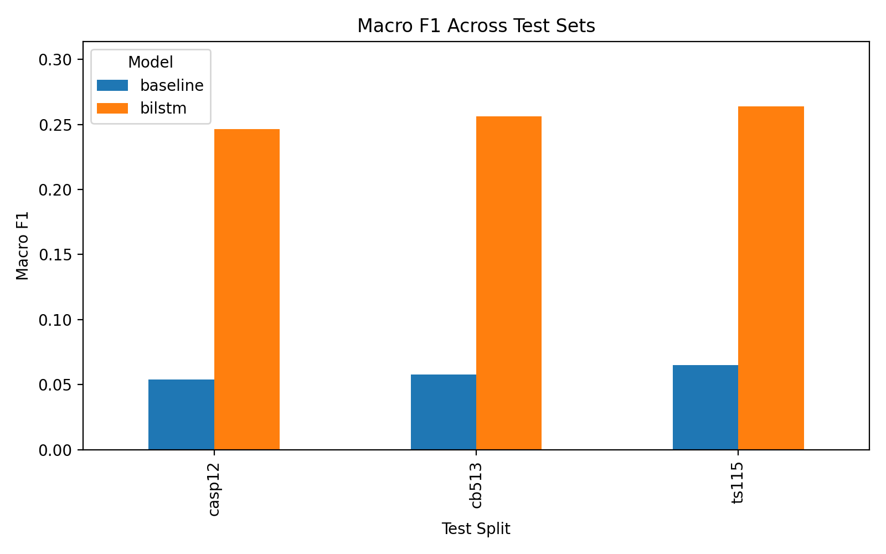
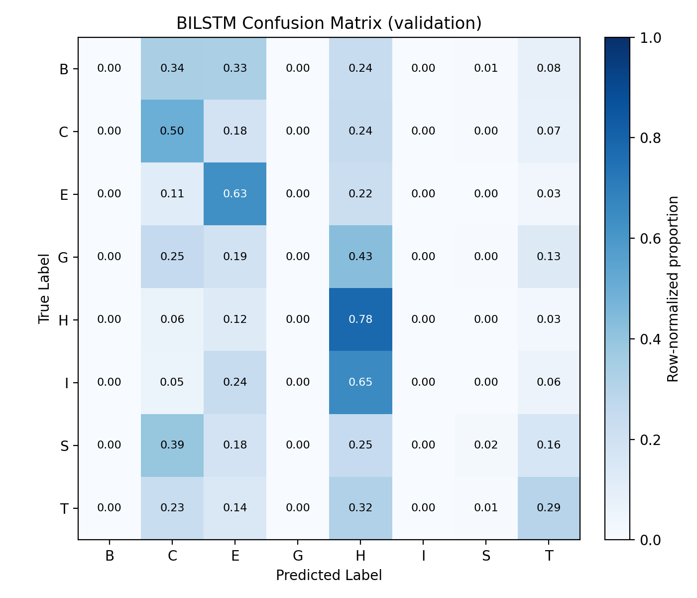

# Protein İkincil Yapı Tahmini

Amino asit dizisinin her kalıntısı için SST8 ikincil yapı etiketi tahmin eden bir makine öğrenmesi projesi. Amaç; bir referans model kurmak, dizi modelinin katkısını ölçmek ve toplam başarı oranının gizleyebildiği sınıf hatalarını incelemektir. Veri kontrolü, deney kayıtları ve sonuçların sınırları çalışmanın parçasıdır.

> Bu paylaşım kopyası kodu, raporu, toplu metrikleri ve grafikleri içerir. Veri dosyaları ve önceki model ağırlıkları ayrı tutulur. Verileri edinme ve dosya adları için [veri notlarına](docs/DATA_SOURCES.md) bak.

## Ne denendi?

Girdi `seq`, hedef aynı uzunluktaki `sst8` sütunudur. Her konum `B, C, E, G, H, I, S, T` etiketlerinden birini alır; mevcut `sst3` sütunu öğrenme hedefi olarak kullanılmaz.

- **Referans:** Eğitim verisindeki en sık etiket olan `H`, bütün konumlar için tahmin edilir.
- **BiLSTM:** Öğrenilen amino asit embedding’leri, çift yönlü LSTM ve konum bazında doğrusal sınıflandırıcı kullanılır.
- **Ön işleme:** Sözlük eğitimden kurulur; `<PAD>` ve `<UNK>` belirteçleri, batch padding ve paketlenmiş diziler kullanılır.
- **Ölçüm:** Padding loss ve metriklerden çıkarılır. Accuracy, macro/ağırlıklı F1, sınıf raporları, karışıklık matrisleri ve uzunluk grupları incelenir.

8.678 eğitim ve 2.170 doğrulama dizisine ek olarak CB513, TS115 ve CASP12 adlı üç test dosyası kullanılır. Kaynak ve ayrım sınırları [veri notlarında](docs/DATA_SOURCES.md) açıklanır.

## Güncel sonuçlar

Bu sürümde **yeni eğitim yapılmadı**. Arşiv değerlendirmesinde kullanılan checkpoint, doğrulama ve üç test dosyasının tamamında CPU üzerinde yeniden değerlendirildi. Aşağıdaki tablo bu güncel çıktıları gösterir; ayrıntılar [model_comparison.csv](outputs/metrics/model_comparison.csv) dosyasındadır.

| Bölüm | H referansı makro F1 | BiLSTM doğruluğu | BiLSTM makro F1 | BiLSTM ağırlıklı F1 |
| --- | ---: | ---: | ---: | ---: |
| Doğrulama | 0.0621 | 0.5348 | 0.2635 | 0.4933 |
| CB513 | 0.0576 | 0.5052 | 0.2560 | 0.4599 |
| TS115 | 0.0650 | 0.5443 | 0.2638 | 0.5024 |
| CASP12 | 0.0538 | 0.4943 | 0.2464 | 0.4544 |

BiLSTM bütün bölümlerde referansı aşar. Ancak doğrulamada `B` ve `I` için duyarlılık ve F1 sıfırdır; `G` duyarlılık yaklaşık **%0,34**, `S` duyarlılık **%1,62** kalır. H, E ve C daha güçlüdür. Bu tablo, doğruluğun tek başına sekiz sınıftaki yeterliliği açıklamadığını gösterir.





Doğrulama metrikleri checkpoint’in kayıtlı bilgileriyle belirtilen toleranslarda uyumludur; makro F1 farkı yaklaşık `2 × 10⁻⁷` olup `10⁻⁶` sınırının içindedir. Birebir sayısal eşitlik veya eğitimin baştan tekrarlandığı iddia edilmez. Denetim kapsamı [EXPERIMENT_AUDIT.md](docs/EXPERIMENT_AUDIT.md) dosyasındadır.

## Güçlü yanlar ve eksikler

- Eğitimden sözlük oluşturma, padding maskesi ve koddaki doğrulama temelli checkpoint seçimi doğru kurulan parçalardır.
- CB513’te 79 tekrar satır ve eğitim/test arasında tam dizi eşleşmeleri vardır; filtrelenmemiştir. Test dosyaları da bazı dizileri paylaşır. Homoloji temelli ayrım denetlenmemiştir.
- Bir checkpoint ve seed `42` içeren bir yapılandırma incelenmiştir; çoklu seed deneyi ve belirsizlik aralığı yoktur.
- Checkpoint’teki `epochs=6`, yapılandırılmış sınırdır; tamamlanan gerçek epok sayısı bilinmez. Bu ağırlıklarla uyumlu eğitim eğrisi bulunmaz.
- Tek yönlü LSTM karşılaştırması ve hiperparametre taraması yoktur; çift yönlülüğün tek başına katkısı veya ayarların en iyi seçenek olduğu gösterilmemiştir.

Sınıf dengesizliği gözlenen hatalarla uyumludur; tek neden olduğunu kanıtlayan kontrollü deney yoktur. Hiperparametrelerin anlamları, olumlu/olumsuz yönler ve eksik deneyler [proje raporunda](docs/PROJECT_REPORT.md) ele alınır.

## Kurulum ve yeniden değerlendirme

Yeniden değerlendirme için yerelde eğittiğin veya kullanım iznin olan uyumlu bir `bilstm_best.pt` dosyası gerekir. Dosyayı `outputs/models/` altına koyabilir ya da `--checkpoint` ile yolunu verebilirsin. Aşağıdaki eğitim komutu yeni ağırlık üretir.

Komutları proje klasöründe çalıştırın. `requirements.txt` sabit sürümler içerir; bu sürümlerle temiz ortam kurulumu sınanmamıştır. Değerlendirmede gözlenen Python ve paket sürümleri denetim belgesinde kayıtlıdır.

**Windows PowerShell:**

```powershell
python -m venv .venv
.\.venv\Scripts\python.exe -m pip install -r requirements.txt
.\.venv\Scripts\python.exe reevaluate_checkpoint.py --output-dir reevaluation
```

**Linux / macOS:**

```bash
python3 -m venv .venv
.venv/bin/python -m pip install -r requirements.txt
.venv/bin/python reevaluate_checkpoint.py --output-dir reevaluation
```

`reevaluation` henüz bulunmayan yeni bir klasör olmalıdır; helper mevcut hedefleri reddeder. Eğitim yapmadan yeni metrik, şekil, tahmin ve log dosyaları üretir. CPU’da iki thread kullanır; batch boyutunu checkpoint yapılandırmasından okur (`16`).

İsteğe bağlı **yeni eğitim deneyi**, aynı sanal ortamın Python’uyla başlatılabilir:

```powershell
.\.venv\Scripts\python.exe run_all.py --epochs 3 --batch-size 16 --device cpu
```

Linux/macOS için aynı komutta Python yolu `.venv/bin/python` olur.

Bu komut güncel sonuçları üreten işlem değildir; eğitim yapar ve varsayılan `outputs/` dosyalarını yeniden yazar. Mevcut arşivi korumak için ayrı bir kopyada kullanın.

## Notebook’lar ve kayıtlar

`protein_sst8_workflow.ipynb`, varsayılan `RUN_TRAINING=False` ile checkpoint’i yükleyip tüm değerlendirme dizilerinde tahmin hesaplar. `notebooks/exploratory_analysis.ipynb` yalnızca kayıtlı çıktıları okur. Hücrelerde yürütülmüş çıktı bulunmaz. Notebook için ortamınıza isteğe bağlı `notebook` ve `ipykernel` paketlerini kurabilirsiniz.

Uyumsuz eski üç epokluk tablolar [legacy arşivinde](archive/legacy_results/README.md) tutulur. Özgün `src/` modülleri ve `run_all.py` korunmuştur; yeniden değerlendirme helper’ı eklenmiş, notebook akışındaki eksik eğitim geçmişi bağımlılıkları düzeltilmiştir. 
